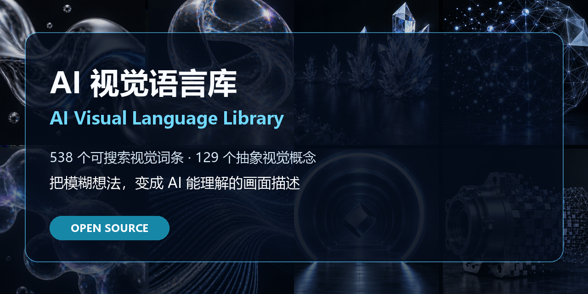

<div align="center">
  
  <h1>AI 视觉语言库<br><sub>AI Visual Language Library</sub></h1>
  <p><strong>把模糊想法，变成 AI 能理解的画面描述。</strong><br>Turn vague visual ideas into precise, copy-ready language for AI.</p>
  <p>
    <a href="https://xuguohua318.github.io/ai-visual-language/"><strong>在线图鉴</strong></a> ·
    <a href="https://github.com/xuguohua318/ai-visual-language/releases/latest"><strong>下载原始资料</strong></a> ·
    <a href="CONTRIBUTING.md"><strong>参与贡献</strong></a>
  </p>
</div>

---

## 为什么做这个项目

和 AI 沟通时，很多人知道自己“想要什么感觉”，却不知道那个画面应该叫什么：是体积散射还是丁达尔光？是流体丝带还是能量丝带？镜头是低机位，还是仰拍？

这个项目把工业影像、摄影镜头、运动变化、剪辑时间、科技可视化、抽象视觉和 AI 表达整理成一套可以搜索、理解和复制的中英双语词汇。它不是一份堆砌形容词的提示词合集，而是一套帮助你把思想翻译成画面的语言工具。

> 如果它帮助你更准确地表达了一个画面，欢迎点一颗 **Star**。你的 Star 会让更多创作者发现这套语言。

## 内容规模

| 内容 | 数量 | 说明 |
|---|---:|---|
| 视觉词条 | 538 | 中英文名称、大白话解释、提示词示例、常见搭配 |
| 提示词模板 | 41 | 图片、视频、抽象视觉与通用模板 |
| 抽象意象映射 | 24 | 将“汇聚、突破、秩序”等概念转换为视觉动作 |
| 抽象视觉概念 | 129 | 粒子、流体、体积、光线、网络、噪声等 |
| 参考图片 | 121 | Web 优化图片，另有 8 项等待社区补充 |

## 三种使用方式

1. **不认识术语时**：打开[在线图鉴](https://xuguohua318.github.io/ai-visual-language/)，用日常语言搜索。
2. **给 AI 下任务时**：打开词条详情，复制提示词示例并替换主体、场景和动作。
3. **做工具或知识库时**：使用 `data/terms.json` 或 `data/terms.csv`，稳定的 `AVL-xxxx` ID 不会因补图或文字修订而改变。

示例：

```text
从“技术把复杂问题变得有序”开始
→ 找到：从混沌到秩序 / From Chaos to Order
→ 视觉动作：无序粒子逐步对齐并形成规则网格
→ 提示词：无序漂浮的银色粒子缓慢汇聚，运动轨迹逐渐整齐，最终排列成精密规则网格。
```

## 数据结构

```json
{
  "id": "AVL-0001",
  "module": "视觉基础",
  "category": "视觉主体",
  "nameZh": "工业设备",
  "nameEn": "Industrial Equipment",
  "plainExplanation": "承担生产或加工任务的完整机器，是工业画面最常见的主角。",
  "promptExample": "一台银灰色激光设备居中静置，外形完整，品牌区域清晰。",
  "commonPairings": "产品主体；整机",
  "abstractIndex": null,
  "image": null
}
```

## 下载与目录

- `data/`：完整 CSV、JSON 和数据校验信息。
- `docs/`：无需构建工具的 GitHub Pages 静态图鉴。
- [v1.0.0 Release](https://github.com/xuguohua318/ai-visual-language/releases/tag/v1.0.0)：原始 Excel、原始 PDF 与 SHA-256 校验值。

原始 PDF 约 360 MB，因此只放在 Release，不进入 Git 历史。仓库中仅保存适合网页浏览的压缩图片。

## 参与贡献

目前 `云雾、体积散射、体积吸收、融合球体、透明软体、流线、噪声、热浪扭曲` 缺少图片。欢迎通过 Issue 模板补图、纠正词条或提交新词条。详见 [CONTRIBUTING.md](CONTRIBUTING.md)。

## License

- 词条、数据、解释、提示词与图片：**CC BY 4.0**
- 网站与转换脚本：**MIT**

署名建议：`AI Visual Language Library by xuguohua318, CC BY 4.0`

---

## English

AI Visual Language Library is a bilingual vocabulary for AI image, video, and industrial-visual creators. It helps people translate an intuitive visual idea into accurate terminology, a plain-language explanation, and a prompt-ready sentence.

Browse 538 terms online, download the CSV/JSON datasets, or use the issue templates to improve the library. Content and images are available under CC BY 4.0; site code and scripts are available under MIT.

If the library helps you describe a visual idea, please **Star the repository** so more creators can find it.
